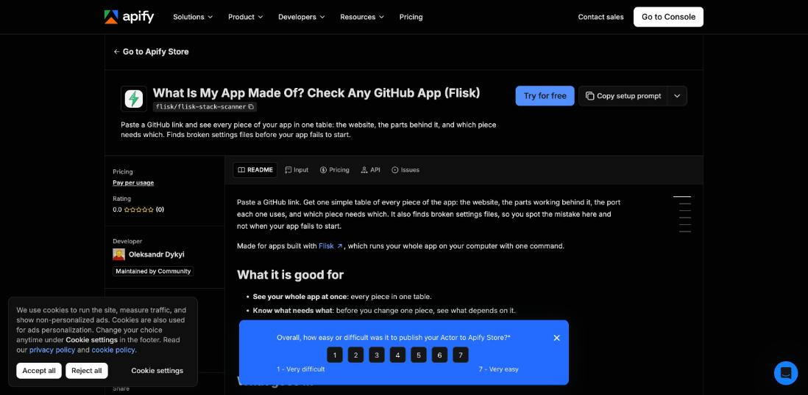
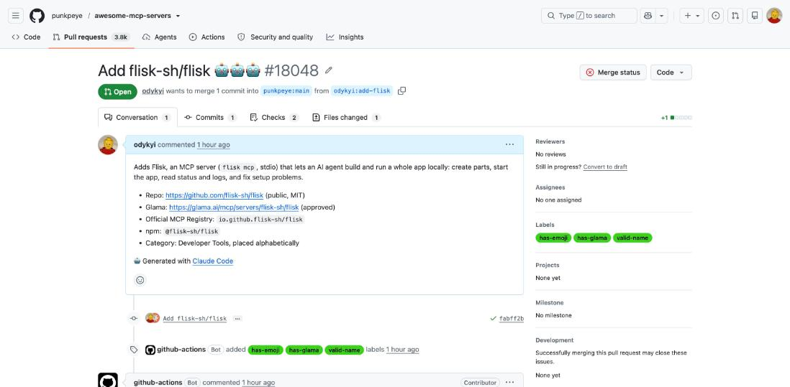
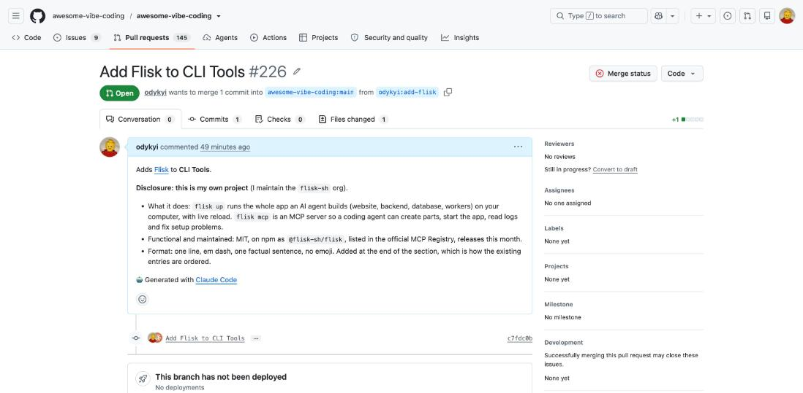
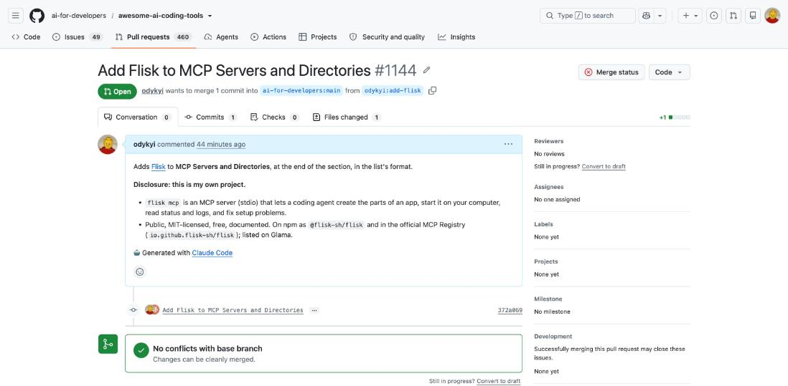

# Flisk Marketplaces

Listings, Actors and packages that make [Flisk](https://flisk.sh) discoverable on public marketplaces. One folder per marketplace.

Flisk builds and runs a whole app on your computer with one command. These listings say that in plain words: what you can build (an online shop, a website, a booking app, an AI helper), not what the tool is called.

## Are we everywhere? Not yet.

Status on **2026-10-30**. Details, rules read and next steps are in [MARKETPLACES.md](MARKETPLACES.md).

| Where | State |
| --- | --- |
| [Apify Store: App Starter](https://apify.com/flisk/flisk-app-starter) | **Live.** Pick what to build, get a working app. Not yet in Store search results (index lag) |
| [Apify Store: App Checker](https://apify.com/flisk/flisk-stack-scanner) | **Live.** Not yet in Store search results |
| [Official MCP Registry](https://registry.modelcontextprotocol.io/?q=flisk) | **Live** as `io.github.flisk-sh/flisk` |
| [Glama](https://glama.ai/mcp/servers/flisk-sh/flisk) | **Live** as "Flisk App Builder". Still to do: claim it and add the [Dockerfile](glama/Dockerfile) so its quality checks run |
| [awesome-mcp-servers](https://github.com/punkpeye/awesome-mcp-servers/pull/18048) | PR open, waiting for review |
| [awesome-vibe-coding](https://github.com/awesome-vibe-coding/awesome-vibe-coding/pull/226) | PR open, waiting for review |
| [awesome-ai-coding-tools](https://github.com/ai-for-developers/awesome-ai-coding-tools/pull/1144) | PR open, waiting for review |
| mcp.so, Cursor Directory, Smithery | Not done: need a login |
| PulseMCP | Submissions paused (as of 2026-10-07) |
| Agent-skills lists (VoltAgent, heilcheng) | Not eligible yet: new repo, 2 stars |

## Evidence

Screenshots taken 2026-10-30 from the live pages.

**Apify: App Starter**


**Apify: App Checker**


**Glama: Flisk App Builder**


**Official MCP Registry**


**Open pull requests**





The Apify screenshots show a cookie banner and a survey bar from Apify's own page.

## What is tested

[`e2e/apify.sh`](e2e/apify.sh) runs both Actors on Apify for real. It downloads every starter from its signed link, checks it holds a valid project and that `flisk up --dry-run` plans it, runs the two website starters' printed steps, and checks the checker on a known-good app. It passes against the public Actors.

```bash
e2e/apify.sh        # needs apify-cli logged in, python3, curl, unzip; flisk is optional
```

## Publish to Apify

```bash
npm i -g apify-cli
apify login
cd apify/actors/flisk-app-starter   # or flisk-stack-scanner
apify push
```

Console fields like the name, description, icon and SEO text are set in Apify Console → Publication and are **not** overwritten by `apify push`.

## Layout

```
apify/actors/flisk-app-starter/    pick what to build, get a working app
apify/actors/flisk-stack-scanner/  see every piece of an app in a GitHub link
apify/assets/                      the Flisk bolt icon
glama/Dockerfile                   for Glama's automated checks
e2e/apify.sh                       end-to-end check of the live Actors
docs/evidence/                     screenshots
MARKETPLACES.md                    every marketplace, its rules and next step
```

Add a new marketplace as its own top-level folder with its own README covering how to publish there.
