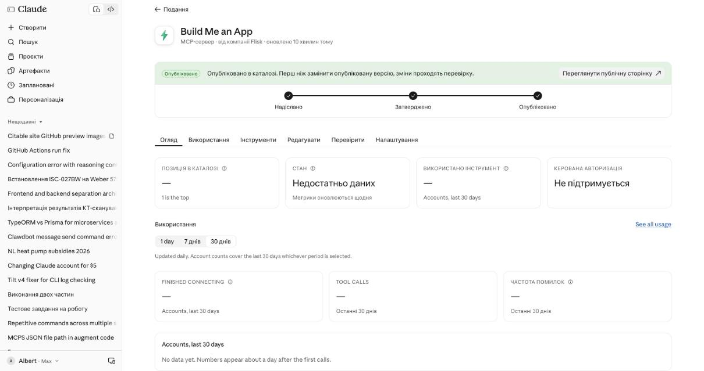
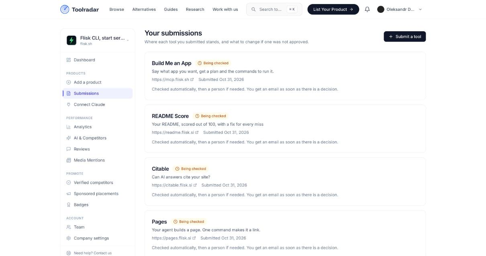
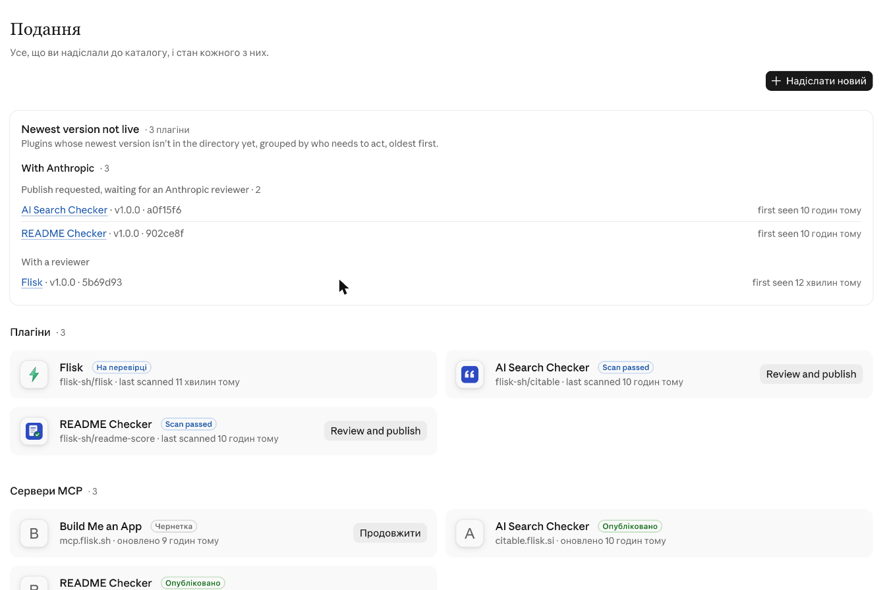
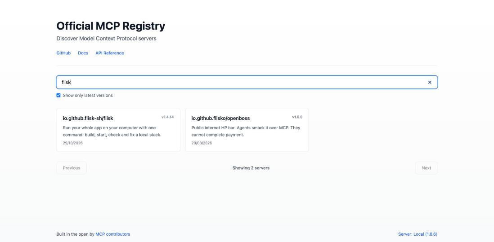
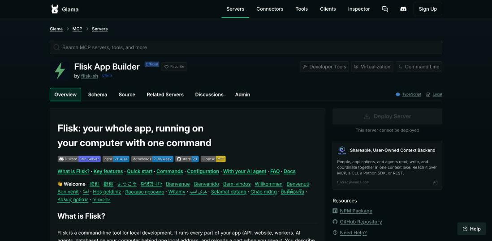
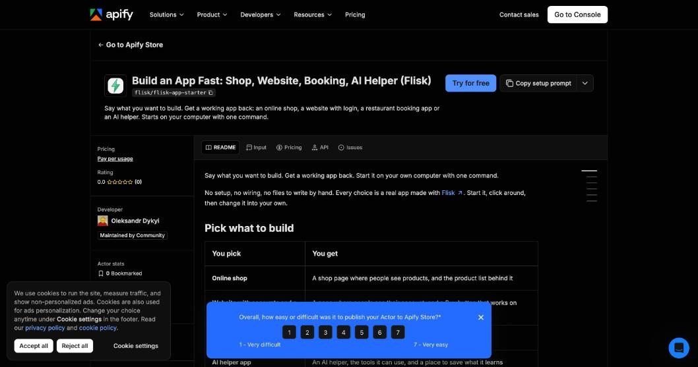

# ⚡ [Flisk](https://flisk.sh): from one sentence to a running app

**Five apps a batch. One board. Every channel.**
Free · no account · no API key · nothing stored

[🔧 Install the servers](INSTALL.md) · [🧭 Full framework](FRAMEWORK.md) · [📜 Marketplace rules](MARKETPLACES.md) · [🧩 Skills](skills) · [🏭 App factory](https://github.com/flisk-sh/app-factory)

---

## 🧭 The board (Zachman, read it like a map)

Columns are the six questions. Rows are the six stages, from idea to proof. Every cell links to where it lives.

| Stage | ❓ [**What**](FRAMEWORK.md#1-the-zachman-matrix) | 🛠 [**How**](FRAMEWORK.md#2-products-tools-prompts-and-servers) | 📍 [**Where**](https://flisk.sh) | 👥 [**Who**](https://claude.com/docs/directory/publish) | ⏱ [**When**](FRAMEWORK.md#3-where-each-product-is-listed) | 💡 [**Why**](https://flisk.sh) |
| --- | --- | --- | --- | --- | --- | --- |
| [**1 · Idea**](FRAMEWORK.md) | [7 products](#-our-apps) | [One command runs a whole app](https://flisk.sh) | [Your computer](https://github.com/flisk-sh/flisk) | [Developers + their AI](INSTALL.md) | [Launch 2026-10-31](https://www.producthunt.com/products/citable-3) | [A running app, no account](https://flisk.sh) |
| [**2 · Promise**](MARKETPLACES.md) | [Free, read-only, keyless](https://build.flisk.si/) | [Plan, check, score](https://pages.flisk.si) | [`*.flisk.si`, `*.flisk.sh`](https://citable.flisk.si) | [The company](https://flisk.sh) | [Per listing](#-distribution-board) | [Trust: nothing stored](https://build.flisk.si/) |
| [**3 · Shape**](INSTALL.md) | [Tools and prompts](#-our-apps) | [Streamable HTTP MCP](https://build.flisk.si/mcp) | [`/mcp` on each host](https://build.flisk.si/mcp) | [Claude, Codex, Gemini](INSTALL.md) | [Versioned](https://github.com/flisk-sh/flisk) | [Names people type](#-our-apps) |
| [**4 · Ship**](https://github.com/flisk-sh/pages) | [5 servers, 5 plugins, CLI](https://www.npmjs.com/package/@flisk-sh/flisk) | [Cloudflare Workers, Render](https://github.com/flisk-sh/citable) | [Cloudflare, Render, GitHub](https://github.com/flisk-sh/readme-score) | [Maintainers](FRAMEWORK.md) | [Deploy on merge](https://github.com/flisk-sh/flisk) | [Small, safe services](https://flisk.sh) |
| [**5 · Listed**](claude-directory/README.md) | [Directories and stores](#-distribution-board) | [Forms, scans, reviews](toolradar/README.md) | [Claude, Toolbox, Glama, PH](https://claude.ai/directory/manage) | [Reviewers](https://claude.com/docs/directory/publish) | [24 h to 10 business days](toolradar/README.md) | [Their trust rules](MARKETPLACES.md) |
| [**6 · Proof**](skills/flisk-test-mcp/evidence/2026-10-31/summary.md) | [91 checks pass, 2 known](skills/flisk-test-mcp/evidence/2026-10-31/summary.md) | [`flisk-test-mcp`](skills/flisk-test-mcp) | [Evidence folder](skills/flisk-test-mcp/evidence/2026-10-31) | [Real users](INSTALL.md) | [Each run](skills/flisk-test-mcp/evidence/2026-10-31) | [Shows what to fix next](skills/flisk-test-mcp/SKILL.md) |

---

## ⚡ Our apps

<table>
<tr>
<td width="50%" valign="top">

### [⚡ Build Me an App](https://build.flisk.si/)
[Say what you want.](https://build.flisk.si/) Get the parts, and [the exact commands](https://github.com/flisk-sh/flisk/tree/main/workers/app-builder-mcp) to run it.
**MCP:** [`build.flisk.si/mcp`](https://build.flisk.si/mcp) · **Tools:** `plan_app`, `list_app_starters` · **Prompts:** `build_my_app`, `pick_a_starter`
[Claude listing](https://claude.ai/directory/flisk-app-builder) · [Glama](https://glama.ai/mcp/servers/flisk-sh/flisk)

</td>
<td width="50%" valign="top">

### [📄 Put My Page Online](https://pages.flisk.si)
[Check a page](https://pages.flisk.si), fix what it lists, [get a free public link](https://pages.flisk.si).
**MCP:** [`pages.flisk.si/mcp`](https://pages.flisk.si/mcp) · **Tools:** `check_page`, `how_to_put_page_online` · **Prompts:** `put_my_page_online`
[Repo](https://github.com/flisk-sh/pages) · [Plugin](https://github.com/flisk-sh/pages/tree/main/plugins/put-my-page-online) · [Toolbox](https://toolradar.com/tools/pages) · [npm](https://www.npmjs.com/package/@flisk-sh/pages) · [GitHub Action](https://github.com/marketplace/actions/flisk-pages-check-and-publish)

</td>
</tr>
<tr>
<td width="50%" valign="top">

### [🔎 Get My Site Found by AI](https://citable.flisk.si)
[Can ChatGPT, Claude and Perplexity find and quote your site?](https://citable.flisk.si) A score and the fix for each problem.
**MCP:** [`citable.flisk.si/mcp`](https://citable.flisk.si/mcp) · **Tools:** `check_site` · **Prompts:** `check_my_site`
[Claude listing](https://claude.ai/directory/ai-search-checker) · [Product Hunt](https://www.producthunt.com/products/citable-3) · [Toolbox](https://toolradar.com/tools/citable-1) · [npm](https://www.npmjs.com/package/@flisk-sh/citable) · [GitHub Action](https://github.com/marketplace/actions/citable-ai-search-score) · [Repo](https://github.com/flisk-sh/citable)

</td>
<td width="50%" valign="top">

### [✅ Improve My README](https://readme.flisk.si)
[A README scored out of 100](https://readme.flisk.si), with [a fix for every miss](https://readme.flisk.si). Same README, same score.
**MCP:** [`readme.flisk.si/mcp`](https://readme.flisk.si/mcp) · **Tools:** `score_readme` · **Prompts:** `improve_my_readme`
[Claude listing](https://claude.ai/directory/readme-checker) · [Toolbox](https://toolradar.com/tools/readme-score) · [GitHub Action](https://github.com/marketplace/actions/readme-score) · [Repo](https://github.com/flisk-sh/readme-score)

</td>
</tr>
</table>

<b>📚 [Flisk docs, Helpdock](https://helpdock.flisk.sh)</b> (a help center, not an app builder)

Ask how to use Flisk in plain words: [`how do I start`, `docs for deploy`, or paste an error](https://helpdock.flisk.sh).
**MCP:** [`helpdock.flisk.sh/mcp`](https://helpdock.flisk.sh/mcp) · **Tools:** `search_docs`, `ask_help_center` · **Prompts:** none yet. Not in the Claude directory yet.

<b>🏭 [App factory: five more, one Worker](https://github.com/flisk-sh/app-factory)</b> (in build: these hosts have no DNS record yet, checked 2026-11-08)

| Product | Host | Tool | What it does |
| --- | --- | --- | --- |
| [**Glossary**](https://glossary.flisk.si) | [glossary.flisk.si](https://glossary.flisk.si/mcp) | `define_term` | Tech words in plain English |
| [**Roast**](https://roast.flisk.si) | [roast.flisk.si](https://roast.flisk.si/mcp) | `roast_idea` | Honest critique of an idea, with a fix |
| [**Match**](https://match.flisk.si) | [match.flisk.si](https://match.flisk.si/mcp) | `match_my_story` | Finds where README and website disagree |
| [**Tagline**](https://tagline.flisk.si) | [tagline.flisk.si](https://tagline.flisk.si/mcp) | `score_taglines` | Scores taglines, picks the best |
| [**Links**](https://links.flisk.si) | [links.flisk.si](https://links.flisk.si/mcp) | `check_links` | Checks up to ten https links |

<b>🧪 More from Flisk</b> (new since the first batch)

| Product | What it does |
| --- | --- |
| [**Flisk Tools**](https://tools.flisk.si/) | Run small web and GitHub tools on your own GitHub, free. A store with no server, no database, no keys |
| [**DevEx Roadmap**](https://roadmap.flisk.si) | A community-edited map of local developer tools |
| [**README Diagram**](https://diagram.flisk.si/) | Turns any README into an animated SVG diagram, no LLM |
| [**Run My Agents**](https://run-my-agents.flisk.si/) | Claude Code, simplified. No server, no keys |
| [**FliskOS**](https://github.com/flisk-sh/fliskos) | A local desktop command center for Flisk projects |
| [**flisk-import**](https://github.com/flisk-sh/flisk-import) | Scans a repo and imports its Procfile, Compose, Dockerfile and package.json services into Flisk |
| [**flisk-export**](https://github.com/flisk-sh/flisk-export) | Writes `render.yaml` and `wrangler.toml` from `service.json`. Files only, it never deploys |
| [**flisk-skills**](https://github.com/flisk-sh/flisk-skills) | Agent skills for the Flisk `service.json` contract |
| [**shunt**](plugins/shunt) | A plugin that saves tokens by sending big file reads to a local model |

---

## 🗺 Distribution board

Checked 2026-11-08. ✅ [live](#-distribution-board) · ⏳ [in review or queued](#-distribution-board) · 🟡 [draft](#-distribution-board) · ⛔ [closed or paid only](#-distribution-board) · ⏸ [parked](#-distribution-board) · ⬜ [not started](#-distribution-board) · — not for this app

| Channel | [Build Me an App](https://build.flisk.si/) | [Put My Page Online](https://pages.flisk.si) | [Get My Site Found by AI](https://citable.flisk.si) | [Improve My README](https://readme.flisk.si) | [Flisk CLI](https://flisk.sh) |
| --- | :---: | :---: | :---: | :---: | :---: |
| [🧰 **Toolbox** (Toolradar)](https://toolradar.com/company/submissions) | [⬜](https://toolradar.com/company/submissions) | [✅](https://toolradar.com/tools/pages) | [✅](https://toolradar.com/tools/citable-1) | [✅](https://toolradar.com/tools/readme-score) | [✅](https://toolradar.com/tools/flisk-cli) |
| [🚀 **Product Hunt**](https://www.producthunt.com/products/citable-3) | [⬜](https://www.producthunt.com/) | [⬜](https://www.producthunt.com/) | [✅](https://www.producthunt.com/products/citable-3) | [⬜](https://www.producthunt.com/) | [✅](https://www.producthunt.com/posts/1289517) |
| [🧩 **Claude directory** (connector)](https://claude.ai/directory/manage) | [✅](https://claude.ai/directory/flisk-app-builder) | [⬜](claude-directory/README.md) | [✅](https://claude.ai/directory/ai-search-checker) | [✅](https://claude.ai/directory/readme-checker) | — |
| [🧩 **Claude directory** (plugin)](https://claude.ai/directory/manage) | — | [⬜](claude-directory/README.md) | [⏳](https://github.com/flisk-sh/citable/tree/main/plugins/ai-search-checker) | [⏳](https://github.com/flisk-sh/readme-score/tree/main/plugins/readme-checker) | [⏳](https://claude.ai/directory/manage/plugins/439072ff-01ae-42bd-8b0f-bc00acbd7d25) |
| [📚 **Official MCP Registry**](https://registry.modelcontextprotocol.io/?q=flisk) | — | [⬜](https://registry.modelcontextprotocol.io/?q=flisk) | [⬜](https://registry.modelcontextprotocol.io/?q=flisk) | [⬜](https://registry.modelcontextprotocol.io/?q=flisk) | [✅](https://registry.modelcontextprotocol.io/?q=flisk) |
| [🔌 **Glama**](https://glama.ai/mcp/servers/flisk-sh/flisk) | — | [⬜](https://glama.ai/) | [⬜](https://glama.ai/) | [⬜](https://glama.ai/) | [✅](https://glama.ai/mcp/servers/flisk-sh/flisk) |
| [🛒 **Apify Store**](https://apify.com/flisk/flisk-app-starter) | — | — | — | — | [✅ Actors](https://apify.com/flisk/flisk-app-starter) |
| [⚙️ **GitHub Actions Marketplace**](https://github.com/marketplace?type=actions) | — | [✅](https://github.com/marketplace/actions/flisk-pages-check-and-publish) | [✅](https://github.com/marketplace/actions/citable-ai-search-score) | [✅](https://github.com/marketplace/actions/readme-score) | — |
| [📦 **npm**](https://www.npmjs.com/package/@flisk-sh/flisk) | — | [✅ 0.3.0](https://www.npmjs.com/package/@flisk-sh/pages) | [✅ 0.1.0](https://www.npmjs.com/package/@flisk-sh/citable) | [⬜](https://github.com/flisk-sh/readme-score) | [✅](https://www.npmjs.com/package/@flisk-sh/flisk) |
| [🤖 **OpenAI** (ChatGPT, Codex)](openai/) | [⏸](openai/) | [⏸](openai/) | [⏸](openai/) | [⏸](openai/) | — |
| [🍺 **Homebrew**](https://github.com/flisk-sh/homebrew-tap) | — | — | — | — | [✅ tap](https://github.com/flisk-sh/homebrew-tap) |
| [🪣 **Scoop** (Windows)](https://github.com/flisk-sh/scoop-bucket) | — | — | — | — | [✅ bucket](https://github.com/flisk-sh/scoop-bucket) |
| [🖱 **Cursor Directory**](https://cursor.directory/plugins/flisk) | — | — | — | — | [⏳ scan failed, re-run asked](https://github.com/cursor/community-plugins/issues/513) |
| [🗂 **mcpservers.org**](https://mcpservers.org/submit) | — | — | — | — | [⏳](https://mcpservers.org/submit) |
| [🗂 **mcp.directory**](https://mcp.directory/submit) | — | — | — | — | [⏳](https://mcp.directory/submit) |
| [🗂 **MCP Market**](https://mcpmarket.com/submit) | — | — | — | — | [⏳](https://mcpmarket.com/submit) |
| [🗂 **Terminal Trove**](https://terminaltrove.com/) | — | — | — | — | [⏳](https://terminaltrove.com/) |
| [⭐ **Awesome lists**](MARKETPLACES.md#other-awesome-lists) | — | — | — | — | [⏳ 3 PRs open](MARKETPLACES.md#other-awesome-lists) |
| [🧠 **skills.sh**](https://skills.sh) | — | — | — | — | [⬜](https://github.com/flisk-sh/flisk-skills) |
| [🐳 **Docker Hub, GHCR**](https://hub.docker.com/u/alexdykyi) | — | — | — | — | [✅ 8 images](https://hub.docker.com/u/alexdykyi) |
| [🏹 **Dev Hunt**](https://devhunt.org/account/tools) | — | [⏳](https://devhunt.org/account/tools) | [⏳](https://devhunt.org/account/tools) | [⏳](https://devhunt.org/account/tools) | [⏳](https://devhunt.org/account/tools) |
| [🔁 **AlternativeTo**](https://alternativeto.net/software/flisk/) | — | — | — | — | [✅](https://alternativeto.net/software/flisk/) |
| [🧭 **SaaSHub**](https://www.saashub.com/flisk) | — | — | — | — | [✅](https://www.saashub.com/flisk) |
| [📁 **SourceForge**](https://sourceforge.net/projects/flisk/) | — | — | — | — | [✅](https://sourceforge.net/projects/flisk/) |
| [💬 **Indie Hackers**](https://www.indiehackers.com/product/flisk) | — | — | — | — | [🟡 page live, posting locked](https://www.indiehackers.com/product/flisk) |
| [🚫 **Smithery, mcp.so, BetaList**](MARKETPLACES.md) | — | — | — | — | [⛔](MARKETPLACES.md#launch-boards-and-product-directories) |

### 🖼 Proof, screenshots

<table>
<tr>
<td width="50%"> <b><a href="https://claude.ai/directory/flisk-app-builder">Claude directory</a>:</b> Build Me an App, published, with its prompts.</td>
<td width="50%"> <b><a href="https://toolradar.com/company/submissions">Toolbox (Toolradar)</a>:</b> four submissions being checked, 2026-10-31.</td>
</tr>
<tr>
<td width="50%"> <b><a href="https://claude.ai/directory/manage">Claude directory</a>:</b> the plugin and connector queue, 2026-10-31.</td>
<td width="50%"> <b><a href="https://registry.modelcontextprotocol.io/?q=flisk">Official MCP Registry</a>:</b> Flisk listed.</td>
</tr>
<tr>
<td width="50%"> <b><a href="https://glama.ai/mcp/servers/flisk-sh/flisk">Glama</a>:</b> Flisk App Builder listed.</td>
<td width="50%"> <b><a href="https://apify.com/flisk/flisk-app-starter">Apify Store</a>:</b> App Starter, live.</td>
</tr>
</table>

---

## 🏭 The app factory: five per batch

| Slot | App | Stage | Next step | Owner |
| :---: | --- | --- | --- | --- |
| 1 | [Build Me an App](https://claude.ai/directory/flisk-app-builder) | [5 · Listed](#-the-board-zachman-read-it-like-a-map) | [Add a Toolbox listing](https://toolradar.com/company/submit) | [User](https://toolradar.com/company/submit) |
| 2 | [Put My Page Online](https://pages.flisk.si) | [5 · Listed](https://github.com/flisk-sh/pages) | [Start the Claude connector and plugin again](claude-directory/README.md): neither is in the submissions list | [User](https://claude.ai/directory/manage) |
| 3 | [Get My Site Found by AI](https://citable.flisk.si) | [5 · Listed](https://www.producthunt.com/products/citable-3) | [Plugin waits for an Anthropic reviewer](claude-directory/README.md) | [Anthropic](https://claude.ai/directory/manage) |
| 4 | [Improve My README](https://readme.flisk.si) | [5 · Listed](https://readme.flisk.si) | [Plugin waits for an Anthropic reviewer](claude-directory/README.md) · [npm](https://www.npmjs.com/package/@flisk-sh/readme-score) | [Anthropic, then user (npm)](https://claude.ai/directory/manage) |
| 5 | [Helpdock](https://helpdock.flisk.sh) | [4 · Ship](https://github.com/flisk-sh/helpdock) | [Add prompts](https://helpdock.flisk.sh/mcp) · [submit to the Claude directory](claude-directory/README.md) | [Maintainer](https://github.com/flisk-sh/helpdock) |
| 6–10 | [next batch](https://github.com/flisk-sh/app-factory) | [1 · Idea](https://github.com/flisk-sh/app-factory) | [Name, promise, four tools](https://github.com/flisk-sh/app-factory) | [Factory planner](https://github.com/flisk-sh/app-factory) |

### ✅ [The per-app checklist](#-the-per-app-checklist)

| # | Step | Proof |
| :---: | --- | --- |
| 1 | [Name it in words people type](FRAMEWORK.md) | [The table above](#-our-apps) |
| 2 | [Server answers initialize, tools, prompts](skills/flisk-test-mcp/SKILL.md) | [Evidence JSON](skills/flisk-test-mcp/evidence/2026-10-31) |
| 3 | [Icon and favicon served](skills/flisk-test-mcp/SKILL.md) | [Test pass](skills/flisk-test-mcp/evidence/2026-10-31/summary.md) |
| 4 | [Read-only, no account, nothing stored](FRAMEWORK.md) | [Reviewer notes](claude-directory/README.md) |
| 5 | [Listing copy, checked](toolradar/README.md) | [Toolbox form](https://toolradar.com/company/submit) |
| 6 | [A screenshot per listing](#-proof-screenshots) | [Proof grid](#-proof-screenshots) |
| 7 | [Submit where a person presses it](claude-directory/README.md) | [Listing status](claude-directory/README.md) |
| 8 | [Launch day](https://www.producthunt.com/products/citable-3) | [Launch page](https://www.producthunt.com/products/citable-3) |

---

## 🧰 Toolbox, Product Hunt, Claude directory

- 🧰 [**Toolbox** is Toolradar](https://toolradar.com/company/submissions): free listing, Auto-fill, two submissions per hour, a domain check. [Rules](toolradar/README.md).
- 🚀 [**Product Hunt**](https://www.producthunt.com/products/citable-3): [Citable launched 2026-10-31](https://www.producthunt.com/products/citable-3), "Your website is the cave wall. Can AI read it?" Flisk has [its own launch](https://www.producthunt.com/posts/1289517). [Launch assets](https://github.com/flisk-sh/citable).
- 🧩 [**Claude directory**](https://claude.ai/directory/manage): [rules and states](claude-directory/README.md).

---

## 🔌 [Use it in your AI](INSTALL.md) (30 seconds)

| Your AI | Do this |
| --- | --- |
| [**Claude** (web, desktop, mobile)](https://claude.ai/directory/flisk-app-builder) | [Settings → Connectors → add the URL](INSTALL.md), or [find it in the directory](https://claude.ai/directory/flisk-app-builder) |
| [**Claude Code**](INSTALL.md) | [`claude mcp add --transport http flisk-app-builder https://build.flisk.si/mcp`](INSTALL.md) |
| [**Gemini CLI, Cursor, Codex**](INSTALL.md) | [Paste the snippet](INSTALL.md) |

Every server is **read-only**: [it plans, checks or scores](FRAMEWORK.md). It creates nothing, sends nothing and stores nothing.

---

## 🧱 [What is still missing](FRAMEWORK.md#4-what-is-missing-and-who-does-it)

| | Gap | Owner |
| :---: | --- | --- |
| 🐳 | [**A `flisk-sh` org on Docker Hub**](https://hub.docker.com/u/alexdykyi): the 8 prebuilt layers are live on `ghcr.io/flisk-sh` and mirrored on `alexdykyi`. Free orgs are gone, so the org needs a paid Docker Team plan | [Maintainer decides](MARKETPLACES.md) |
| 🧩 | [Put My Page Online back in the Claude directory](claude-directory/README.md): connector and plugin are no longer in the submissions list | [User](https://claude.ai/directory/manage) |
| 🔧 | [Helpdock prompts and a Claude listing](claude-directory/README.md) | [Maintainer](https://github.com/flisk-sh/helpdock) |
| 🖱 | [Cursor Directory scan re-run](https://github.com/cursor/community-plugins/issues/513) | [Cursor admin](https://github.com/cursor/community-plugins/issues/513) |
| 💬 | [Indie Hackers launch story](https://www.indiehackers.com/product/flisk): revenue is set to $0 a month, posting is still locked for new members | [Indie Hackers](https://www.indiehackers.com/product/flisk) |
| 📦 | [npm for README Score](https://www.npmjs.com/package/@flisk-sh/readme-score) | [User (npm sign-in)](https://www.npmjs.com/) |
| 🤖 | [OpenAI: ID check, domain tokens, terms, demo video](openai/) | [User, later](openai/) |

<b>🛠 For maintainers</b>

- [📚 Framework (detail)](FRAMEWORK.md) · [📜 Marketplace rules](MARKETPLACES.md) · [🧰 Toolbox](toolradar/README.md) · [🧩 Claude directory](claude-directory/README.md) · [🤖 OpenAI (parked)](openai/)
- Skills: [distribute](skills/flisk-distribute/SKILL.md) · [install](skills/flisk-install-mcp/SKILL.md) · [claude connector](skills/flisk-list-claude-connector/SKILL.md) · [claude plugin](skills/flisk-list-claude-plugin/SKILL.md) · [github action](skills/flisk-list-github-action/SKILL.md) · [marketplaces](skills/flisk-list-marketplaces/SKILL.md) · [openai](skills/flisk-list-openai-plugin/SKILL.md) · [toolbox](skills/flisk-list-toolradar/SKILL.md) · [test](skills/flisk-test-mcp/SKILL.md)
- Test every server and plugin: [`flisk-test-mcp`](skills/flisk-test-mcp/SKILL.md)
- Apify Actors: [`apify/`](apify) · [end-to-end check](e2e/apify.sh)
- Plugins in this repo: [`shunt`](plugins/shunt) saves tokens by sending big file reads to a local model
- Glama build check: [`glama/Dockerfile`](glama/Dockerfile)

