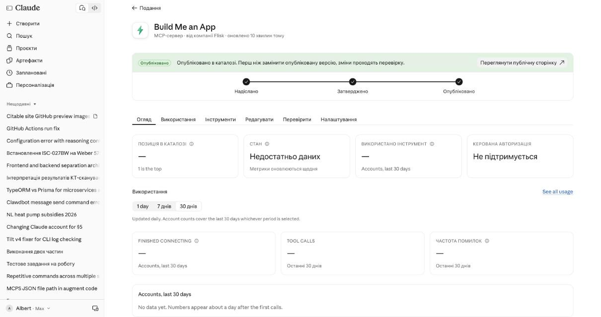
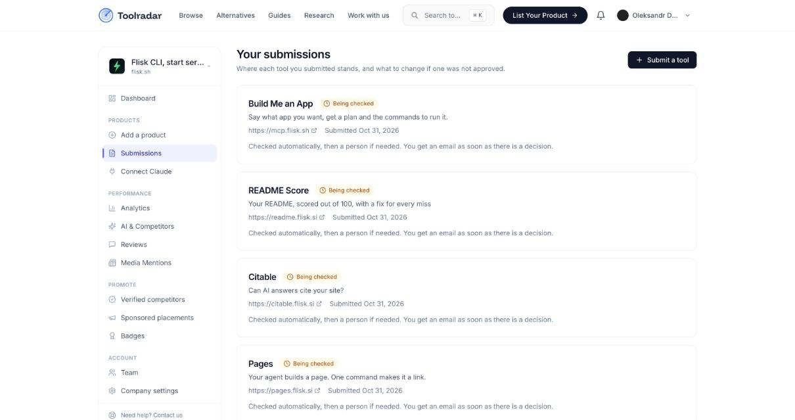
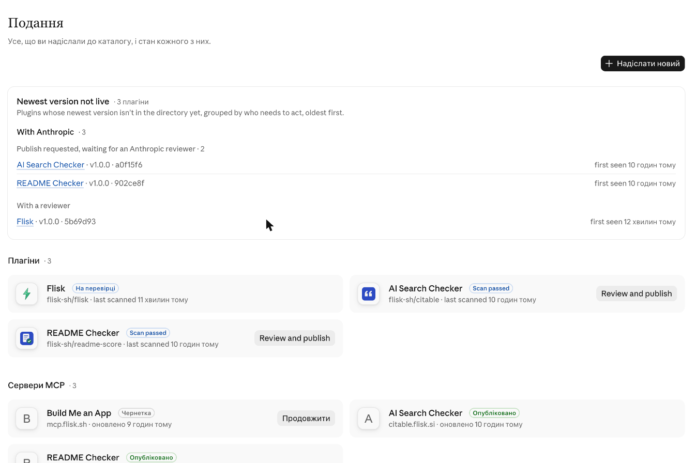
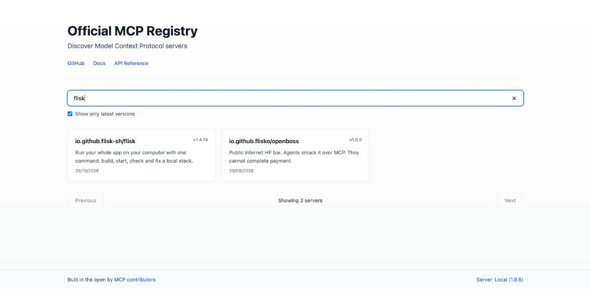
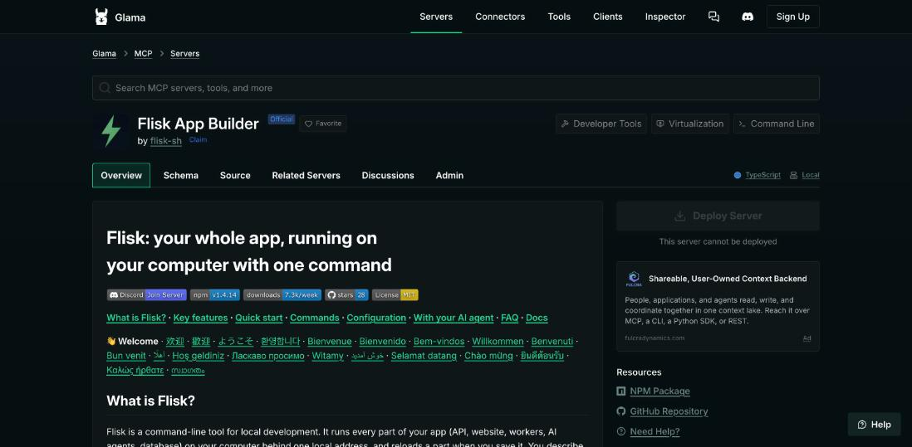
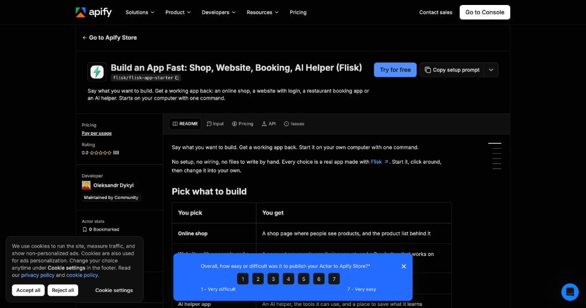

# ⚡ [Flisk](https://flisk.sh): from one sentence to a running app

**Five apps a batch. One board. Every channel.**
Free · no account · no API key · nothing stored

[🔧 Install the servers](INSTALL.md) · [🧭 Full framework](FRAMEWORK.md) · [📜 Marketplace rules](MARKETPLACES.md) · [🧩 Skills](skills) · [🏭 App factory](https://github.com/flisk-sh/app-factory)

---

## 🧭 The board (Zachman, read it like a map)

Columns are the six questions. Rows are the six stages, from idea to proof. Every cell links to where it lives.

| Stage | ❓ [**What**](FRAMEWORK.md#1-the-zachman-matrix) | 🛠 [**How**](FRAMEWORK.md#2-products-tools-prompts-and-servers) | 📍 [**Where**](https://flisk.sh) | 👥 [**Who**](https://claude.com/docs/directory/publish) | ⏱ [**When**](FRAMEWORK.md#3-where-each-product-is-listed) | 💡 [**Why**](https://flisk.sh) |
| --- | --- | --- | --- | --- | --- | --- |
| [**1 · Idea**](FRAMEWORK.md) | [7 products](#-our-apps) | [One command runs a whole app](https://flisk.sh) | [Your computer](https://github.com/flisk-sh/flisk) | [Developers + their AI](INSTALL.md) | [Launch 2026-10-31](https://www.producthunt.com/products/citable-3) | [A running app, no account](https://flisk.sh) |
| [**2 · Promise**](MARKETPLACES.md) | [Free, read-only, keyless](https://mcp.flisk.sh/) | [Plan, check, score](https://pages.flisk.si) | [`*.flisk.si`, `*.flisk.sh`](https://citable.flisk.si) | [The company](https://flisk.sh) | [Per listing](#-distribution-board) | [Trust: nothing stored](https://mcp.flisk.sh/) |
| [**3 · Shape**](INSTALL.md) | [Tools and prompts](#-our-apps) | [Streamable HTTP MCP](https://mcp.flisk.sh/mcp) | [`/mcp` on each host](https://mcp.flisk.sh/mcp) | [Claude, Codex, Gemini](INSTALL.md) | [Versioned](https://github.com/flisk-sh/flisk) | [Names people type](#-our-apps) |
| [**4 · Ship**](https://github.com/flisk-sh/pages) | [4 servers, 4 plugins, CLI](https://www.npmjs.com/package/@flisk-sh/flisk) | [Cloudflare Workers, Render](https://github.com/flisk-sh/citable) | [Cloudflare, Render, GitHub](https://github.com/flisk-sh/readme-score) | [Maintainers](FRAMEWORK.md) | [Deploy on merge](https://github.com/flisk-sh/flisk) | [Small, safe services](https://flisk.sh) |
| [**5 · Listed**](claude-directory/README.md) | [Directories and stores](#-distribution-board) | [Forms, scans, reviews](toolradar/README.md) | [Claude, Toolbox, Glama, PH](https://claude.ai/directory/manage) | [Reviewers](https://claude.com/docs/directory/publish) | [24 h to 10 business days](toolradar/README.md) | [Their trust rules](MARKETPLACES.md) |
| [**6 · Proof**](skills/flisk-test-mcp/evidence/2026-10-31/summary.md) | [91 checks pass, 2 known](skills/flisk-test-mcp/evidence/2026-10-31/summary.md) | [`flisk-test-mcp`](skills/flisk-test-mcp) | [Evidence folder](skills/flisk-test-mcp/evidence/2026-10-31) | [Real users](INSTALL.md) | [Each run](skills/flisk-test-mcp/evidence/2026-10-31) | [Shows what to fix next](skills/flisk-test-mcp/SKILL.md) |

---

## ⚡ Our apps

<table>
<tr>
<td width="50%" valign="top">

### [⚡ Build Me an App](https://mcp.flisk.sh/)
[Say what you want.](https://mcp.flisk.sh/) Get the parts, and [the exact commands](https://github.com/flisk-sh/flisk/tree/main/workers/app-builder-mcp) to run it.
**MCP:** [`mcp.flisk.sh/mcp`](https://mcp.flisk.sh/mcp) · **Tools:** `plan_app`, `list_app_starters` · **Prompts:** `build_my_app`, `pick_a_starter`
[Claude listing](https://claude.ai/directory/flisk-app-builder) · [Toolbox](https://toolradar.com/search?q=build%20me%20an%20app) · [Glama](https://glama.ai/mcp/servers/flisk-sh/flisk)

</td>
<td width="50%" valign="top">

### [📄 Put My Page Online](https://pages.flisk.si)
[Check a page](https://pages.flisk.si), fix what it lists, [get a free public link](https://pages.flisk.si).
**MCP:** [`pages.flisk.si/mcp`](https://pages.flisk.si/mcp) · **Tools:** `check_page`, `how_to_put_page_online` · **Prompts:** `put_my_page_online`
[Repo](https://github.com/flisk-sh/pages) · [Plugin](https://github.com/flisk-sh/pages/tree/main/plugins/put-my-page-online) · [Toolbox](https://toolradar.com/search?q=put%20my%20page%20online)

</td>
</tr>
<tr>
<td width="50%" valign="top">

### [🔎 Get My Site Found by AI](https://citable.flisk.si)
[Can ChatGPT, Claude and Perplexity find and quote your site?](https://citable.flisk.si) A score and the fix for each problem.
**MCP:** [`citable.flisk.si/mcp`](https://citable.flisk.si/mcp) · **Tools:** `check_site` · **Prompts:** `check_my_site`
[Claude listing](https://claude.ai/directory/ai-search-checker) · [Product Hunt](https://www.producthunt.com/products/citable-3) · [npm](https://www.npmjs.com/package/@flisk-sh/citable) · [Repo](https://github.com/flisk-sh/citable)

</td>
<td width="50%" valign="top">

### [✅ Improve My README](https://readme.flisk.si)
[A README scored out of 100](https://readme.flisk.si), with [a fix for every miss](https://readme.flisk.si). Same README, same score.
**MCP:** [`readme.flisk.si/mcp`](https://readme.flisk.si/mcp) · **Tools:** `score_readme` · **Prompts:** `improve_my_readme`
[Claude listing](https://claude.ai/directory/manage/readme-checker) · [Repo](https://github.com/flisk-sh/readme-score) · [Toolbox](https://toolradar.com/search?q=readme%20score)

</td>
</tr>
</table>

<b>📚 [Flisk docs, Helpdock](https://helpdock.flisk.sh)</b> (a help center, not an app builder)

Ask how to use Flisk in plain words: [`how do I start`, `docs for deploy`, or paste an error](https://helpdock.flisk.sh).
**MCP:** [`helpdock.flisk.sh/mcp`](https://helpdock.flisk.sh/mcp) · **Tools:** `search_docs`, `ask_help_center` · **Prompts:** coming soon. The connection fix is [in review](https://github.com/flisk-sh/helpdock/pull/5).

<b>🏭 [App factory: five more, one Worker](https://github.com/flisk-sh/app-factory)</b> (in build)

| Product | Host | Tool | What it does |
| --- | --- | --- | --- |
| [**Glossary**](https://glossary.flisk.si) | [glossary.flisk.si](https://glossary.flisk.si/mcp) | `define_term` | Tech words in plain English |
| [**Roast**](https://roast.flisk.si) | [roast.flisk.si](https://roast.flisk.si/mcp) | `roast_idea` | Honest critique of an idea, with a fix |
| [**Does My Site Match?**](https://match.flisk.si) | [match.flisk.si](https://match.flisk.si/mcp) | `match_my_story` | Finds where README and website disagree |
| [**Pick My Tagline**](https://tagline.flisk.si) | [tagline.flisk.si](https://tagline.flisk.si/mcp) | `score_taglines` | Scores taglines, picks the best |
| [**Check My Links**](https://links.flisk.si) | [links.flisk.si](https://links.flisk.si/mcp) | `check_links` | Checks up to ten https links |

---

## 🗺 Distribution board

✅ [live](#-distribution-board) · ⏳ [in review](#-distribution-board) · 🟡 [draft](#-distribution-board) · ⛔ [blocked](#-distribution-board) · ⬜ [not started](#-distribution-board) · — not for this app

| Channel | [Build Me an App](https://mcp.flisk.sh/) | [Put My Page Online](https://pages.flisk.si) | [Get My Site Found by AI](https://citable.flisk.si) | [Improve My README](https://readme.flisk.si) | [Flisk CLI](https://flisk.sh) |
| --- | :---: | :---: | :---: | :---: | :---: |
| [🧰 **Toolbox** (Toolradar)](https://toolradar.com/company/submissions) | [⏳](https://toolradar.com/search?q=build%20me%20an%20app) | [⏳](https://toolradar.com/search?q=put%20my%20page%20online) | [⏳](https://toolradar.com/search?q=citable) | [⏳](https://toolradar.com/search?q=readme%20score) | [✅](https://toolradar.com/search?q=flisk%20cli) |
| [🚀 **Product Hunt**](https://www.producthunt.com/products/citable-3) | [⬜](https://www.producthunt.com/) | [⬜](https://www.producthunt.com/) | [✅](https://www.producthunt.com/products/citable-3) | [⬜](https://www.producthunt.com/) | [⬜](https://www.producthunt.com/) |
| [🧩 **Claude directory** (connector)](https://claude.ai/directory/manage) | [✅](https://claude.ai/directory/flisk-app-builder) | [🟡](https://claude.ai/directory/manage/new/connector) | [✅](https://claude.ai/directory/ai-search-checker) | [✅](https://claude.ai/directory/manage/readme-checker) | — |
| [🧩 **Claude directory** (plugin)](https://claude.ai/directory/manage) | — | [⏳](https://github.com/flisk-sh/pages/tree/main/plugins/put-my-page-online) | [⏳](https://github.com/flisk-sh/citable/tree/main/plugins/ai-search-checker) | [⏳](https://github.com/flisk-sh/readme-score/tree/main/plugins/readme-checker) | [⏳](https://claude.ai/directory/manage/plugins/439072ff-01ae-42bd-8b0f-bc00acbd7d25) |
| [📚 **Official MCP Registry**](https://registry.modelcontextprotocol.io/?q=flisk) | — | [⬜](https://registry.modelcontextprotocol.io/?q=flisk) | [⬜](https://registry.modelcontextprotocol.io/?q=flisk) | [⬜](https://registry.modelcontextprotocol.io/?q=flisk) | [✅](https://registry.modelcontextprotocol.io/?q=flisk) |
| [🔌 **Glama**](https://glama.ai/mcp/servers/flisk-sh/flisk) | — | [⬜](https://glama.ai/) | [⬜](https://glama.ai/) | [⬜](https://glama.ai/) | [✅](https://glama.ai/mcp/servers/flisk-sh/flisk) |
| [🛒 **Apify Store**](https://apify.com/flisk/flisk-app-starter) | — | — | — | — | [✅ Actors](https://apify.com/flisk/flisk-app-starter) |
| [⚙️ **GitHub Actions Marketplace**](https://github.com/flisk-sh/pages) | — | [⬜](https://github.com/flisk-sh/pages) | [⬜](https://github.com/flisk-sh/citable) | [⬜](https://github.com/flisk-sh/readme-score) | — |
| [📦 **npm**](https://www.npmjs.com/package/@flisk-sh/flisk) | — | [⬜](https://github.com/flisk-sh/pages) | [✅ 0.1.0](https://www.npmjs.com/package/@flisk-sh/citable) | [⬜](https://github.com/flisk-sh/readme-score) | [✅](https://www.npmjs.com/package/@flisk-sh/flisk) |
| [🤖 **OpenAI** (ChatGPT, Codex)](openai/) | [⏸](openai/) | [⏸](openai/) | [⏸](openai/) | [⏸](openai/) | — |
| [🔧 **Smithery, mcp.so, Cursor**](MARKETPLACES.md) | [⬜](MARKETPLACES.md) | [⬜](MARKETPLACES.md) | [⬜](MARKETPLACES.md) | [⬜](MARKETPLACES.md) | [⬜](MARKETPLACES.md) |

### 🖼 Proof, screenshots

<table>
<tr>
<td width="50%"> <b><a href="https://claude.ai/directory/flisk-app-builder">Claude directory</a>:</b> Build Me an App, published, with its prompts.</td>
<td width="50%"> <b><a href="https://toolradar.com/company/submissions">Toolbox (Toolradar)</a>:</b> four submissions being checked.</td>
</tr>
<tr>
<td width="50%"> <b><a href="https://claude.ai/directory/manage">Claude directory</a>:</b> the plugin and connector queue.</td>
<td width="50%"> <b><a href="https://registry.modelcontextprotocol.io/?q=flisk">Official MCP Registry</a>:</b> Flisk listed.</td>
</tr>
<tr>
<td width="50%"> <b><a href="https://glama.ai/mcp/servers/flisk-sh/flisk">Glama</a>:</b> Flisk App Builder listed.</td>
<td width="50%"> <b><a href="https://apify.com/flisk/flisk-app-starter">Apify Store</a>:</b> App Starter, live.</td>
</tr>
</table>

---

## 🏭 The app factory: five per batch

| Slot | App | Stage | Next step | Owner |
| :---: | --- | --- | --- | --- |
| 1 | [Build Me an App](https://claude.ai/directory/flisk-app-builder) | [5 · Listed](#-the-board-zachman-read-it-like-a-map) | [Tick and Submit](https://claude.ai/directory/manage/flisk-app-builder) · [Toolbox review](https://toolradar.com/company/submissions) | [User (ticks)](https://claude.ai/directory/manage/flisk-app-builder) |
| 2 | [Put My Page Online](https://pages.flisk.si) | [4 · Ship](https://github.com/flisk-sh/pages) | [Terms and Submit](https://claude.ai/directory/manage/new/connector) · [Toolbox confirm](https://toolradar.com/company/submissions) | [User, then agent](https://claude.ai/directory/manage) |
| 3 | [Get My Site Found by AI](https://citable.flisk.si) | [5 · Listed](https://www.producthunt.com/products/citable-3) | [Product Hunt reply](https://www.producthunt.com/products/citable-3) · [publish plugin](https://claude.ai/directory/manage) | [User](https://claude.ai/directory/manage) |
| 4 | [Improve My README](https://readme.flisk.si) | [5 · Listed](https://readme.flisk.si) | [Publish plugin](https://claude.ai/directory/manage) · [npm](https://www.npmjs.com/package/@flisk-sh/readme-score) | [User](https://claude.ai/directory/manage) |
| 5 | [Helpdock](https://helpdock.flisk.sh) | [4 · Ship](https://github.com/flisk-sh/helpdock/pull/5) | [Approve the deploy](https://github.com/flisk-sh/helpdock/pull/5) · [prompts](https://helpdock.flisk.sh/mcp) | [User approves](https://github.com/flisk-sh/helpdock/pull/5) |
| 6–10 | [next batch](https://github.com/flisk-sh/app-factory) | [1 · Idea](https://github.com/flisk-sh/app-factory) | [Name, promise, four tools](https://github.com/flisk-sh/app-factory) | [Factory planner](https://github.com/flisk-sh/app-factory) |

### ✅ [The per-app checklist](#-the-per-app-checklist)

| # | Step | Proof |
| :---: | --- | --- |
| 1 | [Name it in words people type](FRAMEWORK.md) | [The table above](#-our-apps) |
| 2 | [Server answers initialize, tools, prompts](skills/flisk-test-mcp/SKILL.md) | [Evidence JSON](skills/flisk-test-mcp/evidence/2026-10-31) |
| 3 | [Icon and favicon served](skills/flisk-test-mcp/SKILL.md) | [Test pass](skills/flisk-test-mcp/evidence/2026-10-31/summary.md) |
| 4 | [Read-only, no account, nothing stored](FRAMEWORK.md) | [Reviewer notes](claude-directory/README.md) |
| 5 | [Listing copy, checked](toolradar/README.md) | [Toolbox form](https://toolradar.com/company/submit) |
| 6 | [A screenshot per listing](#-proof-screenshots) | [Proof grid](#-proof-screenshots) |
| 7 | [Submit where a person presses it](claude-directory/README.md) | [Listing status](claude-directory/README.md) |
| 8 | [Launch day](https://www.producthunt.com/products/citable-3) | [Launch page](https://www.producthunt.com/products/citable-3) |

---

## 🧰 Toolbox, Product Hunt, Claude directory

- 🧰 [**Toolbox** is Toolradar](https://toolradar.com/company/submissions): free listing, Auto-fill, two submissions per hour, a domain check. [Rules](toolradar/README.md).
- 🚀 [**Product Hunt**](https://www.producthunt.com/products/citable-3): [Citable launched today](https://www.producthunt.com/products/citable-3), "Your website is the cave wall. Can AI read it?" [Launch assets](https://github.com/flisk-sh/citable).
- 🧩 [**Claude directory**](https://claude.ai/directory/manage): [rules and states](claude-directory/README.md).

---

## 🔌 [Use it in your AI](INSTALL.md) (30 seconds)

| Your AI | Do this |
| --- | --- |
| [**Claude** (web, desktop, mobile)](https://claude.ai/directory/flisk-app-builder) | [Settings → Connectors → add the URL](INSTALL.md), or [find it in the directory](https://claude.ai/directory/flisk-app-builder) |
| [**Claude Code**](INSTALL.md) | [`claude mcp add --transport http flisk-app-builder https://mcp.flisk.sh/mcp`](INSTALL.md) |
| [**Gemini CLI, Cursor, Codex**](INSTALL.md) | [Paste the snippet](INSTALL.md) |

Every server is **read-only**: [it plans, checks or scores](FRAMEWORK.md). It creates nothing, sends nothing and stores nothing.

---

## 🧱 [What is still missing](FRAMEWORK.md#4-what-is-missing-and-who-does-it)

| | Gap | Owner |
| :---: | --- | --- |
| 🐳 | [**Prebuilt Docker layers on Docker Hub**](https://hub.docker.com/u/flisk-sh) under `flisk-sh`: L1 to L3, then L4 (faster first run for the demo) | [Maintainer](FRAMEWORK.md) |
| 🔧 | [Helpdock connection fix deployed](https://github.com/flisk-sh/helpdock/pull/5) | [User approves deploy](https://github.com/flisk-sh/helpdock/pull/5) |
| 📦 | [npm for README Score and Pages](https://www.npmjs.com/) | [User (npm sign-in)](https://www.npmjs.com/) |
| ⚙️ | [GitHub Actions Marketplace for Pages, Citable, README Score](https://github.com/marketplace?type=actions) | [Maintainer](https://github.com/marketplace?type=actions) |
| 🤖 | [OpenAI: ID check, domain tokens, terms, demo video](openai/) | [User, later](openai/) |

<b>🛠 For maintainers</b>

- [📚 Framework (detail)](FRAMEWORK.md) · [📜 Marketplace rules](MARKETPLACES.md) · [🧰 Toolbox](toolradar/README.md) · [🧩 Claude directory](claude-directory/README.md) · [🤖 OpenAI (parked)](openai/)
- Skills: [distribute](skills/flisk-distribute/SKILL.md) · [install](skills/flisk-install-mcp/SKILL.md) · [claude connector](skills/flisk-list-claude-connector/SKILL.md) · [claude plugin](skills/flisk-list-claude-plugin/SKILL.md) · [github action](skills/flisk-list-github-action/SKILL.md) · [marketplaces](skills/flisk-list-marketplaces/SKILL.md) · [openai](skills/flisk-list-openai-plugin/SKILL.md) · [toolbox](skills/flisk-list-toolradar/SKILL.md) · [test](skills/flisk-test-mcp/SKILL.md)
- Test every server and plugin: [`flisk-test-mcp`](skills/flisk-test-mcp/SKILL.md)
- Apify Actors: [`apify/`](apify) · [end-to-end check](e2e/apify.sh)
- Glama build check: [`glama/Dockerfile`](glama/Dockerfile)

