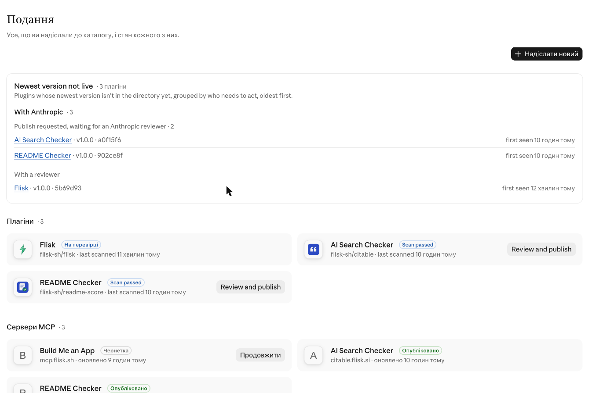

# Claude directory

Listings for `claude.ai/directory/manage` (Anthropic's directory of connectors and plugins). Status as of **2026-11-08**, read from `claude.ai/directory/manage` (the 2026-10-31 notes are kept where a row has not been re-checked).
The playbook, with every trap hit so far, is the skill in [`skills/flisk-distribute`](../skills/flisk-distribute/SKILL.md).

## Connectors (one remote MCP server each)

| Display name | Slug | Server | State on 2026-11-08 |
| --- | --- | --- | --- |
| Build Me an App | `flisk-app-builder` (slug can't change) | `https://mcp.flisk.sh/mcp` | **Published**, updated the day before; used a tool: 10 accounts in the last 30 days. Prompts `build_my_app`, `pick_a_starter` |
| Get My Site Found by AI | `ai-search-checker` | `https://citable.flisk.si/mcp` | **Published**; 184 accounts used a tool in the last 30 days. Prompt `check_my_site` |
| Improve My README | `readme-checker` | `https://readme.flisk.si/mcp` | **Published**; 3 accounts used a tool in the last 30 days. Prompt `improve_my_readme` |
| Put My Page Online | `put-my-page-online` | `https://pages.flisk.si/mcp` | **Not in the submissions list** on 2026-11-08 (it was a draft at step 8 of 10 on 2026-10-31). The server is live at `pages.flisk.si/mcp`; the maintainer finishes the draft or starts it again. Prompt `put_my_page_online` |

Every listing's icon is its server's own `https://<host>/icon-512.png`.

Not listed yet: Helpdock (`https://helpdock.flisk.sh/mcp`, "Flisk docs" help center; it is not an app builder).

## Plugins (a folder in a GitHub repo)

| Plugin | Repo and path | State on 2026-11-08 |
| --- | --- | --- |
| Flisk | `flisk-sh/flisk`, `plugins/flisk-claude` | **Needs changes**: "Directory policy refused this version" (v1.0.0, 0eb9553). It shipped a local MCP server (`.mcp.json`) and a shell launcher, which only Verified organizations may. **Fixed** in flisk-sh/flisk#3373 (skills only), merged 2026-11-08; a rescan ("Check for new commits") was started and had not finished when this was written |
| AI Search Checker | `flisk-sh/citable`, `plugins/ai-search-checker` | Scan passed (v1.0.0, b469558); publish requested, **waiting for an Anthropic reviewer** since the day before |
| README Checker | `flisk-sh/readme-score`, `plugins/readme-checker` | Scan passed (v1.0.0, a69f9ef); publish requested, **waiting for an Anthropic reviewer** |
| Put My Page Online | `flisk-sh/pages`, `plugins/put-my-page-online` | **Not in the submissions list** on 2026-11-08 (form was at step 4 of 5 on 2026-10-31, waiting for the terms boxes and Submit). Its plugin folder is already clean (checked 2026-11-08: only `plugin.json`, the icon, and an `.mcp.json` with the public URL) |

## Rules we follow

- Every connector lists its **prompts** as well as its tools, and the prompts must answer `prompts/list` on the live server first.

- Names are the words people type, in plain English.
- The directory takes the favicon of the registrable domain, so always set a custom icon URL to the server's own `/icon-512.png`.
- Flisk is not a Verified organization, so a plugin may carry no MCP server that runs on the user's computer and no file except Markdown, text, JSON, YAML and images (details in the `flisk-list-claude-plugin` skill).
- A person ticks the policy checkboxes and presses the final Submit; everything else can be filled by an agent.
- MCP host is `<app host>/mcp`.

## Evidence

Taken 2026-10-31 from `claude.ai/directory/manage` (the list only, no account details):

What it shows: plugin Flisk **with a reviewer**; plugins AI Search Checker and README Checker **scan passed, publish requested, waiting for an Anthropic reviewer**; connectors AI Search Checker and README Checker **published**; connector Build Me an App **draft**. The two published connectors still show a letter ("A", "B") in this list instead of their icon: the custom icon URL is set on the listing, and the public page needs a re-check.
